<!-- ========================================================================= -->
<!-- A. HERO SECTION                                                           -->
<!-- ========================================================================= -->

 

  <code>───  01 / IDENTITY  ───</code>

---

<!-- ========================================================================= -->
<!-- B. ABOUT ME & C. CURRENTLY WORKING ON                                     -->
<!-- ========================================================================= -->

<h2 align="center">👋 About Me</h2>

  Hi! I'm <strong>Rakin</strong>, an Information Technology student and aspiring Frontend Developer from Indonesia.

  I enjoy building practical web applications, exploring new technologies, and turning ideas into functional digital experiences.

 

<table align="center">
  <tr>
    <td width="50%" valign="top">
      <h3>💻 What I Do</h3>
      <ul>
        <li>Build web applications using JavaScript, HTML, and CSS.</li>
        <li>Develop interactive interfaces with React.</li>
        <li>Explore programming through hands-on projects.</li>
        <li>Practice problem-solving and software development.</li>
      </ul>
    </td>
    <td width="50%" valign="top">
      <h3>🌱 What I'm Exploring</h3>
      <ul>
        <li>React & Frontend Development</li>
        <li>Node.js & Backend Fundamentals</li>
        <li>Java & Object-Oriented Programming</li>
        <li>Database Management with MySQL</li>
      </ul>
    </td>
  </tr>
</table>

 

<h3 align="center">🎯 My Career Goal</h3>

  To grow as a Frontend Developer, contribute to meaningful products,
  and collaborate with teams to build useful digital experiences.

  <em>Learning by building. Growing through consistency.</em>

---

<!-- ========================================================================= -->
<!-- D. TECH STACK                                                             -->
<!-- ========================================================================= -->

<h2 align="center">⚙️ Tech Stack</h2>

  Technologies and tools I use to build projects and improve my development skills.

<h3 align="center">💻 Programming & Web Development</h3>

  

<h3 align="center">🛠️ Tools & Platforms</h3>

  

<h3 align="center">🌱 Currently Learning</h3>

  

  <em>Always learning, building, and exploring new technologies.</em>

---

<!-- ========================================================================= -->
<!-- E. FEATURED PROJECTS                                                      -->
<!-- ========================================================================= -->
<h2 align="center">🌿 Featured Projects</h2>

  A collection of projects I've built while learning and exploring software development.

 

<table>
  <tr>
    <td width="50%" valign="top">
      <h3 align="center">01. ToDo List</h3>
      

        A personal task management application with user authentication and individual task storage.
      

      

        <strong>Tech Stack</strong> 
        JavaScript · HTML · CSS · LocalStorage
      

      

        <a href="https://rakinziyad30-bot.github.io/ToDoList/">Live Demo</a>
        &nbsp;·&nbsp;
        <a href="https://github.com/rakinziyad30-bot/ToDoList">Source Code</a>
      

    </td>
    <td width="50%" valign="top">
      <h3 align="center">02. Expense Tracker</h3>
      

        A finance tracking application to manage income, expenses, balances, and transaction history.
      

      

        <strong>Tech Stack</strong> 
        JavaScript · HTML · CSS · LocalStorage
      

      

        <a href="https://rakinziyad30-bot.github.io/ExpensesTracker/">Live Demo</a>
        &nbsp;·&nbsp;
        <a href="https://github.com/rakinziyad30-bot/ExpensesTracker">Source Code</a>
      

    </td>
  </tr>
  <tr>
    <td width="50%" valign="top">
      <h3 align="center">03. Crypto Tracker</h3>
      

        A cryptocurrency tracking dashboard that retrieves and displays market information using an external API.
      

      

        <strong>Tech Stack</strong> 
        JavaScript · HTML · CSS · API Integration
      

      

        <a href="https://rakinziyad30-bot.github.io/CryptoTracker/">Live Demo</a>
        &nbsp;·&nbsp;
        <a href="https://github.com/rakinziyad30-bot/CryptoTracker">Source Code</a>
      

    </td>
    <td width="50%" valign="top">
      <h3 align="center">04. Java Parking System</h3>
      

        A parking management program developed as an object-oriented programming project.
      

      

        <strong>Tech Stack</strong> 
        Java · Object-Oriented Programming
      

      

        <a href="https://github.com/rakinziyad30-bot/ProgramParkir">Source Code</a>
      

    </td>
  </tr>
</table>

 

  <em>Building, learning, and improving one project at a time.</em>

---

<!-- ========================================================================= -->
<!-- F. GITHUB ANALYTICS                                                       -->
<!-- ========================================================================= -->
<h2 align="center">📊 GitHub Analytics</h2>

  A small overview of my development activity and coding journey.

  
  

  <em>Every commit is a small step forward.</em>

---

<!-- ========================================================================= -->
<!-- G. CONTRIBUTION SNAKE                                                     -->
<!-- ========================================================================= -->

  <code>───  05 / CONTRIBUTION CADENCE  ───</code>

<h3>Contribution Snake</h3>

Generated automatically every 24 hours via GitHub Actions onto the <code>output</code> branch

<picture>
  <source
    media="(prefers-color-scheme: dark)"
    srcset="https://raw.githubusercontent.com/rakinziyad30-bot/rakinziyad30-bot/output/github-contribution-grid-snake-dark.svg"
  />
  <source
    media="(prefers-color-scheme: light)"
    srcset="https://raw.githubusercontent.com/rakinziyad30-bot/rakinziyad30-bot/output/github-contribution-grid-snake.svg"
  />
  
</picture>

---

<!-- ========================================================================= -->
<!-- H. CONNECT WITH ME                                                        -->
<!-- ========================================================================= -->

  <code>───  06 / CORRESPONDENCE  ───</code>

<h3>Connect With Me</h3>

Open to learning opportunities, collaborative student projects, and frontend discussions

<!--
  NOTE FOR CUSTOMIZATION:
  Replace the placeholder URLs below with your personal LinkedIn URL, email address, and portfolio site.
-->

  
  &nbsp;&nbsp;
  
  &nbsp;&nbsp;
  
  &nbsp;&nbsp;
  

  <strong>Placeholders:</strong> Update <code>YOUR-LINKEDIN-USERNAME</code>, <code>your.email@example.com</code>, and <code>your-portfolio-url.example.com</code> in <code>README.md</code>.

 

---

<!-- ========================================================================= -->
<!-- I. FOOTER                                                                 -->
<!-- ========================================================================= -->

   
  

    <em>"Thanks for visiting my little corner of GitHub."</em>
  

  

    <code>Muhammad Rakin Ziyad</code> &nbsp;·&nbsp; <code>@rakinziyad30-bot</code> &nbsp;·&nbsp; <code>Building, Learning, and Growing.</code>
  

   

<h2 align="center">Contribution Garden 🌿</h2>

  

<h2 align="center">GitHub Analytics</h2>

  
  

 

<h2 align="center">Coding Consistency</h2>

  

