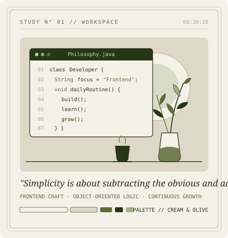

<!-- ========================================================================= -->
<!-- A. HERO SECTION                                                           -->
<!-- ========================================================================= -->

 

  <code>───  01 / IDENTITY  ───</code>

---

<!-- ========================================================================= -->
<!-- B. ABOUT ME & C. CURRENTLY WORKING ON                                     -->
<!-- ========================================================================= -->

<table>
  <tr>
    <td width="62%" valign="top">
      <h3><code>01.</code> &nbsp;About Me</h3>
      

        Hello, I'm <strong>Muhammad Rakin Ziyad</strong> — an Information Technology student with a quiet appreciation for thoughtful interfaces, clean structure, and how software comes together under the hood.
      

      

        Right now, my focus is grounded in the fundamentals: writing semantic markup, understanding how state and data flow through modern frontend applications, and strengthening my object-oriented programming foundation. I treat every small project as a study in craft—figuring out why things work, where they break, and how to build them more clearly the next time.
      

      <blockquote>
        <em>"Building, Learning, and Growing."</em>
      </blockquote>
       
      <h3><code>02.</code> &nbsp;Currently Working On</h3>
      <ul>
        <li><strong>Learning React</strong> — Component architecture, hooks, and declarative UI state.</li>
        <li><strong>Improving JavaScript Skills</strong> — Asynchronous patterns, DOM manipulation, and ES6+ fundamentals.</li>
        <li><strong>Building Personal Projects</strong> — Translating core concepts into functional, self-contained web apps.</li>
        <li><strong>Practicing Java Programming</strong> — Object-oriented design, data structures, and console/system logic.</li>
      </ul>
    </td>
    <td width="38%" valign="middle" align="center">
      
       
      <em>Fig 01. — Structure, patience, and iterative craft.</em>
    </td>
  </tr>
</table>

---

<!-- ========================================================================= -->
<!-- D. TECH STACK                                                             -->
<!-- ========================================================================= -->

  <code>───  02 / TOOLS &amp; FOUNDATIONS  ───</code>

<h3>Tech Stack &amp; Environment</h3>

Technologies I am actively studying and building with

<table align="center">
  <thead>
    <tr>
      <th align="center" width="220">Frontend Foundations</th>
      <th align="center" width="220">Backend &amp; Database</th>
      <th align="center" width="220">Workflow &amp; Environment</th>
    </tr>
  </thead>
  <tbody>
    <tr>
      <td align="center" valign="middle">
         
        
          
        <code>HTML5</code> · <code>CSS3</code> · <code>JavaScript</code> · <code>React</code>
          
      </td>
      <td align="center" valign="middle">
         
        
          
        <code>Java</code> · <code>MySQL</code>
          
      </td>
      <td align="center" valign="middle">
         
        
          
        <code>Git</code> · <code>GitHub</code> · <code>VS Code</code>
          
      </td>
    </tr>
  </tbody>
</table>

---

<!-- ========================================================================= -->
<!-- E. FEATURED PROJECTS                                                      -->
<!-- ========================================================================= -->

  

    <code>───  03 / SELECTED WORKS  ───</code>
  

  <h3>Featured Projects</h3>
  
Foundational exercises in state management, API integration, and object-oriented design

<!--
  NOTE FOR CUSTOMIZATION:
  Replace the placeholder href links (e.g., https://github.com/rakinziyad30-bot/YOUR-REPO-NAME)
  with your exact repository URLs once published on your GitHub account.
-->

<table width="100%">
  <tr>
    <td width="50%" valign="top">
      <h4><code>01</code> &nbsp;ToDo List Application</h4>
      

        A task management interface built with vanilla JavaScript featuring persistent client-side storage and user authentication flow.
      

      

        <strong>Focus:</strong> <code>JavaScript</code> · <code>localStorage</code> · <code>Authentication</code>
      

      

        <!-- Placeholder Link: Update with verified repo URL -->
        <a href="https://github.com/rakinziyad30-bot?tab=repositories"><code>[ View Repository → ]</code></a>
        &nbsp;<em>(Placeholder — link to repo)</em>
      

    </td>
    <td width="50%" valign="top">
      <h4><code>02</code> &nbsp;Expense Tracker</h4>
      

        A personal finance utility designed to record, categorize, and calculate real-time balances across income and expense entries.
      

      

        <strong>Focus:</strong> <code>JavaScript</code> · <code>State &amp; Math Logic</code> · <code>DOM Updates</code>
      

      

        <!-- Placeholder Link: Update with verified repo URL -->
        <a href="https://github.com/rakinziyad30-bot?tab=repositories"><code>[ View Repository → ]</code></a>
        &nbsp;<em>(Placeholder — link to repo)</em>
      

    </td>
  </tr>
  <tr>
    <td width="50%" valign="top">
      <h4><code>03</code> &nbsp;Crypto Tracker</h4>
      

        A live market dashboard that fetches and displays cryptocurrency price data, market cap metrics, and 24-hour trends via external REST APIs.
      

      

        <strong>Focus:</strong> <code>JavaScript</code> · <code>REST API Integration</code> · <code>Async/Await</code>
      

      

        <!-- Placeholder Link: Update with verified repo URL -->
        <a href="https://github.com/rakinziyad30-bot?tab=repositories"><code>[ View Repository → ]</code></a>
        &nbsp;<em>(Placeholder — link to repo)</em>
      

    </td>
    <td width="50%" valign="top">
      <h4><code>04</code> &nbsp;Java Parking System</h4>
      

        A structured vehicle slot and ticketing management system built to practice core object-oriented programming principles in Java.
      

      

        <strong>Focus:</strong> <code>Java</code> · <code>Object-Oriented Programming</code> · <code>Encapsulation</code>
      

      

        <!-- Placeholder Link: Update with verified repo URL -->
        <a href="https://github.com/rakinziyad30-bot?tab=repositories"><code>[ View Repository → ]</code></a>
        &nbsp;<em>(Placeholder — link to repo)</em>
      

    </td>
  </tr>
</table>

---

<!-- ========================================================================= -->
<!-- F. GITHUB ANALYTICS                                                       -->
<!-- ========================================================================= -->

  <code>───  04 / ACTIVITY &amp; METRICS  ───</code>

<h3>GitHub Analytics</h3>

Live metrics styled in Warm Cream (<code>#F4F1E8</code>), Olive Green (<code>#606C38</code>), and Dark Olive (<code>#283618</code>)

<!-- Primary Metrics: GitHub Stats & Most Used Languages -->
<table align="center">
  <tr>
    <td align="center" valign="middle">
      
    </td>
    <td align="center" valign="middle">
      
    </td>
  </tr>
</table>

<!-- Custom Cream & Olive Styled Cards + Streak -->

  
<code>[ + ]</code> &nbsp;Expand Detailed Custom-Palette Cards, Streak &amp; Trophies

   

  <!-- Custom Colored Stats & Top Languages (via github-readme-stats with Cream/Olive hex parameters) -->
  

    
    
  

  <!-- Contribution Streak -->
  

    
  

  <!-- GitHub Trophies -->
  

    
  

 

<!-- Contribution Graph (Cream & Olive custom palette) -->

  

---

<!-- ========================================================================= -->
<!-- G. CONTRIBUTION SNAKE                                                     -->
<!-- ========================================================================= -->

  <code>───  05 / CONTRIBUTION CADENCE  ───</code>

<h3>Contribution Snake</h3>

Generated automatically every 24 hours via GitHub Actions onto the <code>output</code> branch

<picture>
  <source
    media="(prefers-color-scheme: dark)"
    srcset="https://raw.githubusercontent.com/rakinziyad30-bot/rakinziyad30-bot/output/github-contribution-grid-snake-dark.svg"
  />
  <source
    media="(prefers-color-scheme: light)"
    srcset="https://raw.githubusercontent.com/rakinziyad30-bot/rakinziyad30-bot/output/github-contribution-grid-snake.svg"
  />
  
</picture>

---

<!-- ========================================================================= -->
<!-- H. CONNECT WITH ME                                                        -->
<!-- ========================================================================= -->

  <code>───  06 / CORRESPONDENCE  ───</code>

<h3>Connect With Me</h3>

Open to learning opportunities, collaborative student projects, and frontend discussions

<!--
  NOTE FOR CUSTOMIZATION:
  Replace the placeholder URLs below with your personal LinkedIn URL, email address, and portfolio site.
-->

  
  &nbsp;&nbsp;
  
  &nbsp;&nbsp;
  
  &nbsp;&nbsp;
  

  <strong>Placeholders:</strong> Update <code>YOUR-LINKEDIN-USERNAME</code>, <code>your.email@example.com</code>, and <code>your-portfolio-url.example.com</code> in <code>README.md</code>.

 

---

<!-- ========================================================================= -->
<!-- I. FOOTER                                                                 -->
<!-- ========================================================================= -->

   
  

    <em>"Thanks for visiting my little corner of GitHub."</em>
  

  

    <code>Muhammad Rakin Ziyad</code> &nbsp;·&nbsp; <code>@rakinziyad30-bot</code> &nbsp;·&nbsp; <code>Building, Learning, and Growing.</code>
  

   

<h2 align="center">Contribution Garden 🌿</h2>

  

 

